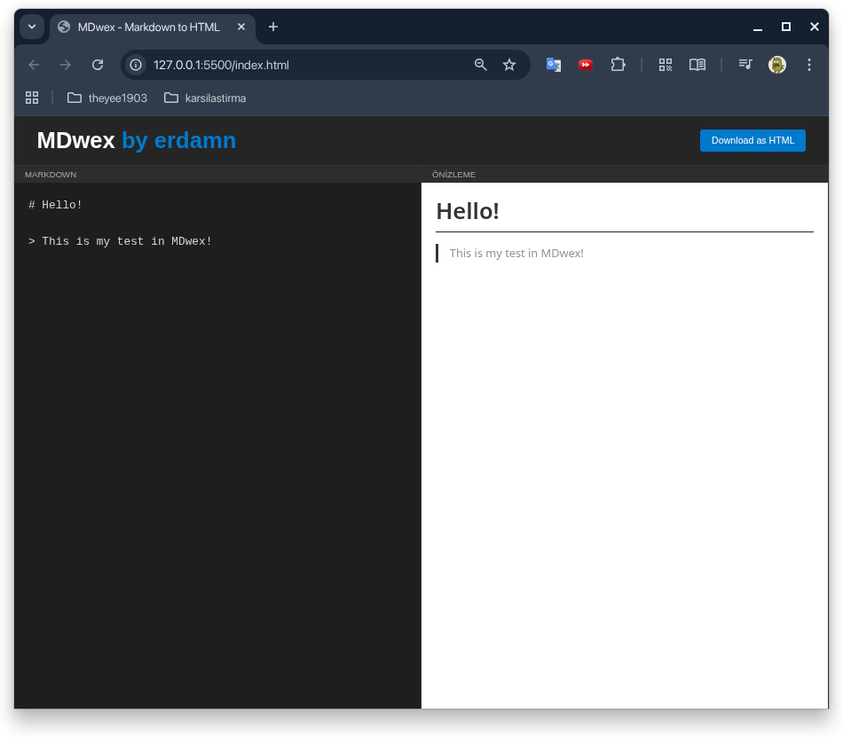

# MDwex

A simple and efficient Markdown editor and converter with live preview and download functionality.

---

## Features ✨

- Convert Markdown to HTML in real-time
- Download HTML files
- Easy-to-use interface
- Fast processing
- HTML5 + JS based

---

## Installation 

```bash
git clone https://github.com/YusufErdemK/MDwex.git
cd MDwex
```

Then open `index.html` in your web browser.

### Requirements
- A modern web browser (Chrome, Firefox, Edge, etc.)
---


## Usage

1. Open `index.html` in your web browser.
2. Type or paste your Markdown content into the left textarea.
3. The converted HTML will appear in the right preview area in real-time.
4. Click the "Download HTML" button to save the converted HTML as a file.


## Screenshot



## How It Works

MDwex uses HTML5 Canvas and JavaScript to process Markdown and convert it into HTML. The Markdown is first parsed and then rendered into HTML elements, which are displayed in the preview area.

---

## License

MIT License - see LICENSE file for details

---

## Author
Developed by erdamn (Yusuf Erdem Kaymak)

## Social Medias

[](https://github.com/YusufErdemK)&nbsp;&nbsp;
[](https://www.instagram.com/theyee1903/)